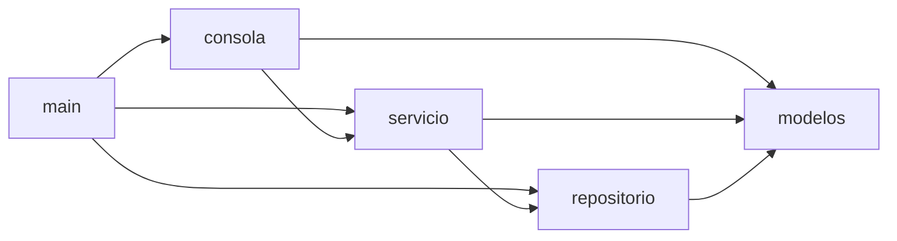

# Decisiones técnicas

## Estructura de la versión refactorizada

| Archivo | Responsabilidad | Depende de |
|---|---|---|
| main.py | Arma las dependencias y arranca la consola. Es el único lugar que conoce el nombre del archivo de datos. | consola, servicio, repositorio, errores |
| consola.py | Menú, lectura de datos y mensajes al usuario. | servicio, modelos, errores |
| servicio.py | Reglas de negocio: registrar, cambiar estado, asignar, filtrar y contar. | repositorio (solo la abstracción), modelos, errores |
| repositorio.py | Lectura y escritura de las solicitudes en el archivo JSON. | modelos, errores |
| modelos.py | Entidades, estados, prioridades y validaciones de datos. | errores |
| errores.py | Errores propios del sistema. | Ninguno |

Todos los módulos usan `errores.py`.

## Decisiones

1. **Escribir las pruebas de comportamiento antes de tocar el código.** Son la red de seguridad del refactoring: si alguna falla después de un cambio, ese cambio alteró lo que ve el usuario.

2. **Refactorizar en pasos chicos, un commit por técnica.** Cada paso se puede revisar y revertir por separado, y el historial muestra el antes y el después de cada refactoring.

3. **Conservar los defectos durante el refactoring y corregirlos en un paso aparte.** Un refactoring no debe cambiar el comportamiento. Separar las correcciones permite demostrar con las mismas pruebas que los pasos anteriores no lo cambiaron.

4. **Separar en modelos, repositorio, servicio y consola.** Cada módulo tiene una sola responsabilidad y las dependencias van en una sola dirección.

5. **Repositorio detrás de una abstracción (Protocol).** El servicio no depende del archivo JSON: se puede probar con un repositorio en memoria y cambiar a otra forma de guardar sin tocarlo.

6. **Enumeraciones para estado y prioridad, sin distinguir mayúsculas.** Los valores válidos se definen una sola vez y todas las comparaciones siguen la misma regla.

7. **Guardar la prioridad como texto y no cambiar el formato del JSON.** Los archivos creados con la versión inicial, que aceptaba cualquier prioridad, se siguen pudiendo leer.

8. **Errores propios en lugar de True o False.** Cada error lleva su causa y la consola la muestra; las reglas de negocio no imprimen nada.

9. **No sobrescribir un archivo de datos dañado.** Ante un archivo ilegible el programa informa el problema y termina con código 1, en lugar de empezar vacío y perder los datos al guardar.

10. **Mismo límite de línea (100) para Pylint y Flake8.** Las dos herramientas aplican el mismo criterio y no se contradicen.

## Refactorings aplicados

| N° | Técnica | Smells que resuelve | Commit |
|---|---|---|---|
| 1 | Extract Method | Long Method, Duplicated Code | Extraer metodos del menu principal y unificar la lectura del ID |
| 2 | Replace Magic Literal (reemplazar literales por una enumeración) | Magic Strings / Primitive Obsession | Reemplazar los textos de estado por una enumeracion |
| 3 | Introduce Parameter Object | Long Parameter List, Data Clumps | Introducir objetos de parametros para registrar y asignar |
| 4 | Move Method | Feature Envy, lógica mezclada con presentación | Mover el comportamiento y el formato de la solicitud a la clase Solicitud |
| 5 | Extract Class (separación en módulos e inversión de la dependencia) | God Module, acoplamiento directo a la persistencia | Separar el sistema en modelos, repositorio, servicio y consola |
| 6 | Replace Conditional with Dispatch Table (tabla de opciones) | Switch Statements | Separar el sistema en modelos, repositorio, servicio y consola |
| 7 | Replace Error Code with Exception | Manejo de errores por valores de retorno y validación incompleta | Corregir defectos visibles con validaciones y mensajes de error especificos |

## Principios SOLID

| Principio | Versión inicial | Versión refactorizada |
|---|---|---|
| SRP (responsabilidad única) | main.py concentraba menú, lectura de teclado, validaciones, reglas, formato y acceso al archivo. | Cada módulo tiene una sola razón para cambiar: la consola solo interactúa con el usuario, el servicio aplica las reglas, el repositorio guarda y lee, y cada entidad valida y formatea sus propios datos. |
| OCP (abierto/cerrado) | Agregar un estado obligaba a modificar tres lugares, y agregar una opción, la cadena de if/elif y el texto del menú. | La validación, el reporte, el mensaje de error y el texto del menú se generan desde la enumeración Estado: agregar un estado es agregar una línea. El menú es una tabla de opciones: agregar una opción es agregar una entrada. |
| LSP (sustitución de Liskov) | No había abstracciones, así que el principio no tenía dónde aplicarse. | El servicio funciona con cualquier implementación de RepositorioSolicitudes: en las pruebas unitarias se reemplaza RepositorioJSON por un repositorio en memoria sin cambiar nada del servicio. Estado y Prioridad heredan de OpcionDeTexto y se usan de la misma forma. |
| ISP (segregación de interfaces) | No había interfaces. | La abstracción del repositorio expone solo las dos operaciones que el servicio necesita (cargar_todas y guardar_todas). No se dividieron más interfaces porque no hay clientes con necesidades distintas; hacerlo agregaría complejidad sin beneficio. |
| DIP (inversión de dependencias) | Las operaciones de negocio llamaban directamente a guardar(), que escribía un archivo con una ruta fija. | ServicioSolicitudes depende de la abstracción RepositorioSolicitudes y recibe la implementación por su constructor. main.py es el único lugar que conoce RepositorioJSON y el nombre del archivo. |
